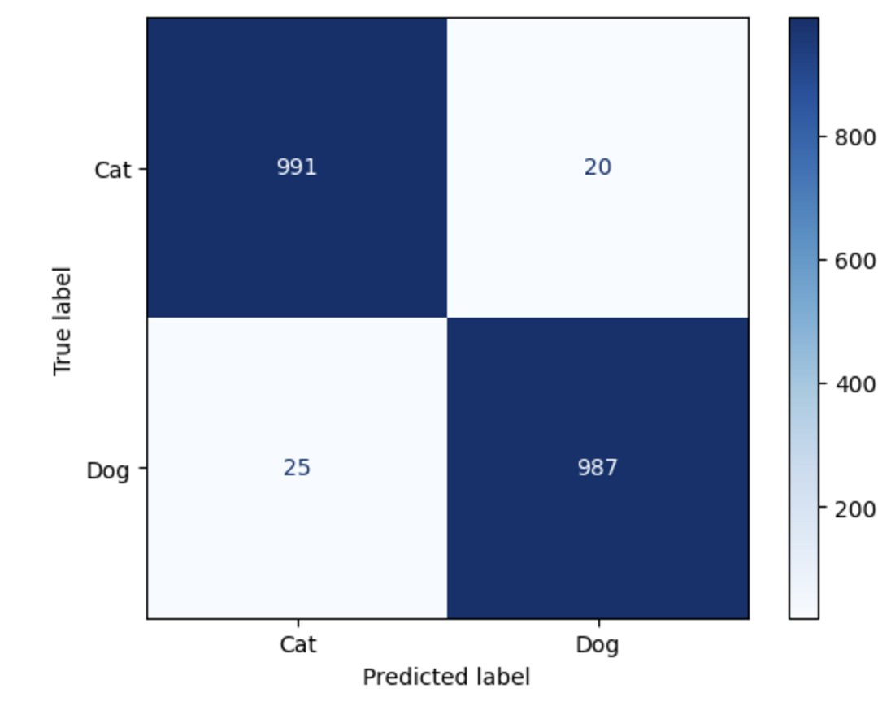

# Cat & Dog CNN

> 사진 한 장을 입력받아 고양이와 강아지를 구분하는 PyTorch 이미지 분류 프로젝트

**Python · PyTorch · TorchVision · ResNet-18**

인하공업전문대학 전공심화 머신러닝 프로젝트 · 2024

[](https://github.com/withoutsultang/Cat-and-Dog-CNN/actions/workflows/smoke.yml)

## 제가 한 일

- **이미지 분류 파이프라인 구축** — 고양이·강아지 이미지를 RGB로 변환하고 224×224 리사이즈와 정규화를 적용해 학습 입력으로 구성했습니다.
- **모델과 학습 조건 비교** — VGG-16에서 시작해 Dropout과 손실 함수를 바꿔 실험했습니다. 최종 모델은 사전 학습된 ResNet-18의 분류층을 단일 확률을 출력하는 구조로 바꾸고, BCELoss와 Adam으로 학습했습니다.
- **결과를 오분류까지 분석** — 정확도와 함께 혼동행렬을 작성해 두 클래스에서 각각 어떤 분류 오류가 발생했는지 확인했습니다.

## 실험 결과

기말 발표 자료의 혼동행렬을 기준으로 **2,023장 중 1,978장을 올바르게 분류**했습니다. 해당 평가의 정확도는 **97.78%**입니다.



## 실행

[Kaggle 데이터셋](https://www.kaggle.com/datasets/tongpython/cat-and-dog)의 학습 이미지를 `training_set/cats/`와 `training_set/dogs/`에 준비합니다.

```bash
python -m pip install -r requirements.txt
python train.py --data-dir training_set --n_epochs 10
python predict.py path/to/image.jpg --weights outputs/resnet18.pth
```

포트폴리오 버전은 시드 기반 80:20 학습·검증 분할, 검증 전체 샘플 집계, 단일 이미지 추론 명령을 제공합니다.

[자동 실행 검증](scripts/smoke.py)은 합성 이미지로 CPU 학습, 체크포인트 저장, 이미지 추론까지 실행합니다.

| 살펴볼 코드 | 내용 |
| --- | --- |
| [실험 노트북](machineLearning_catvsdog.ipynb) | 데이터 확인, 모델 비교, 시각화 |
| [모델](model.py) · [데이터셋](utils.py) | VGG-16, ResNet-18, 이미지 입력 처리 |
| [학습](train.py) · [검증](trainer.py) · [추론](predict.py) | 체크포인트 저장과 이미지 예측 |
